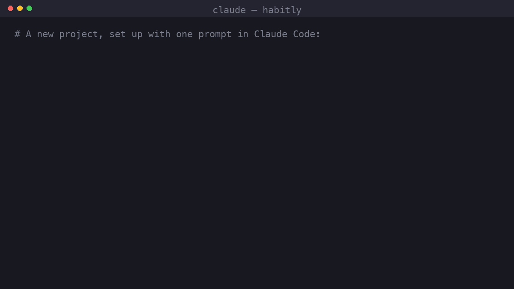

# Claude Plugins

A Claude Code plugin marketplace. It currently contains one plugin, **crew**, which takes the repeated manual setup out of starting a project.



## Install

```bash
claude plugin marketplace add aanand-3/claude-plugins
claude plugin install crew@aanand-plugins
```

Start a new Claude Code session to load it. To pick up later releases, run `claude plugin marketplace update aanand-plugins`.

## crew

| Skill | Invoke | Purpose |
|---|---|---|
| research | `/crew:research <idea>` | Standalone, before or after kickoff. Finds competitors, open-source prior art and user complaints, lists features worth adopting, gives a rough bottom-up market estimate, and recommends **go / pivot / kill**. Every claim cites evidence that a script has fetched and checked. Writes `docs/research/` |
| kickoff | `/crew:kickoff <idea>` | New projects. Asks which optional modules you want (hub, code graph), then runs discover, design, guidelines, hub, git, graph and the idea, goals and first plan in order, and can resume after an interruption |
| onboard | `/crew:onboard` | Existing projects. Maps the repo (with graphify if chosen), infers the stack and layout and confirms them with you, then merges config, docs, CLAUDE.md, rules and git guards into what's there, on a `chore/crew-onboard` branch. Leaves existing hooks and CI alone unless you say otherwise |
| discover | `/crew:discover` | Interview → `.crew/config.yaml`, brief, architecture, ADRs |
| design | `/crew:design [init\|page\|review\|refresh]` | A gallery page of all of Sanzo Wada's *Dictionary of Color Combinations*, each previewed as UI with WCAG-checked roles for light and dark. You shortlist 2–4, and each becomes a full style tile to compare. The pick becomes `docs/design/DESIGN.md` (tokens, layout shell, component inventory, do's and don'ts). Pages are composed from it, and `check_design.py` flags drift |
| guidelines | `/crew:guidelines` | `CLAUDE.md`, path-scoped `.claude/rules/` from stack packs, settings, hygiene files |
| hub | `/crew:hub …` | The team's shared context in `.crew/` (Node ≥ 20 CLI, no install): the idea with its success criteria and the focus goal, goals, a ranked backlog of FEAT/BUG/CHORE/SPIKE items with priority, and plans with verifiable tasks and a declared footprint (`touches:`; one branch and one PR per plan). Enforced gates: no skeletons, triage, Definition of Ready, WIP limit, the idea's decision. A shared ledger (in the git common dir) records claims, moves, logs and spend from every worktree and agent, so parallel agents can't take the same plan. Project memory: `learn` records decisions, gotchas, conventions and risks scoped to paths, `recall` brings back what applies to a plan (and the org playbook's lessons), and a plan can't go to review without naming its learnings. A central policy (`.crew/policy.yaml` over an org playbook layer) sets the mode, human and role gates, reserved decisions, models, tools, paths and budgets; guardrails only tighten, and `policy show` names the layer every value came from. `next` names the single best next step; `status` reports where the work stands, who owns what and what it cost; `migrate` converts a project-kit `.project/`. An interactive view (`export` for an offline page, `ui` for a live local server): executive overview, board, hierarchy, dependency graph and linked document pages. The plugin also registers the hub as MCP tools (`next`, `status`, `graph`, `new_item`, `triage`, `move`, `log`, `focus`, `usage`, `learn`, `recall`, `ledger`, …), so agents call typed tools behind the same gates instead of shelling out |
| codemap | `/crew:codemap [enable\|build\|remove]` | Optional code knowledge graph via [graphify](https://pypi.org/project/graphifyy/): installs the CLI with your yes, wires its rebuild-on-commit hook and CLAUDE.md section, gitignores `graphify-out/`, and builds the graph so Claude queries it instead of reading files broadly |
| git-setup | `/crew:git-setup` | git init, `.gitignore`, PR template, hooks that protect `main` and enforce Conventional Commits |
| global-setup | `/crew:global-setup` | One-time install of the Karpathy-style working principles into `~/.claude/CLAUDE.md` |

### Optional modules
Kickoff and onboard ask which of these to include. The choice is recorded in `.crew/config.yaml → modules:`.

| Module | Default | When off |
|---|---|---|
| `hub` | on | Nothing hub-related is generated: no `.crew/bin/crew.mjs`, idea, goals or plans, and no hub lines in CLAUDE.md, settings, hooks, the PR template or CI. `main` is still protected, and any branch name works (`feat/<slug>`, `fix/<slug>`, …) |
| `graphify` | off | No graph. When on, `graphify-out/` is local and gitignored, and on machines without graphify, commits still succeed |

### Existing projects
Run `/crew:onboard` in the repo (clean working tree). It works on a `chore/crew-onboard` branch, so `main` is never touched, and opens a PR at the end. Kickoff points you there when it finds existing code.

### Upgrading from project-kit
crew 1.0 replaces project-kit 0.x. Install `crew@aanand-plugins`, then in each project on a clean `main`:

```bash
node ~/.claude/plugins/marketplaces/aanand-plugins/plugins/crew/skills/hub/dist/crew.mjs migrate
```

or ask Claude to run `/crew:hub migrate`. It turns `.project/` into `.crew/`: epics become goals (`EP-` → `G-`), points, milestones and sprints are dropped (milestone exit criteria join their goals' acceptance criteria), RAID rows become knowledge entries, and the rest is archived in `.crew/archive/`. It then lists the files to re-render (`/crew:guidelines --refresh`, `/crew:git-setup`). Write the idea (`new-idea`) and set the focus goal afterwards.

### What a kicked-off project looks like

```
CLAUDE.md                      # project facts + "how we work"
.claude/
  settings.json                # plan-mode drafts in .crew/drafts, hub hook, safety denies
  rules/                       # base.md + project.md (always) + stack/arch packs (path-scoped)
.crew/
  config.yaml                  # every stack/architecture decision, read by all skills
  idea.md                      # problem, outcome, success criteria, direction; holds the focus goal
  goals/G-001-<slug>.md        # outcome; its breakdown becomes FEAT items
  items/FEAT-001-<slug>.md     # backlog: FEAT / BUG / CHORE / SPIKE with priority, severity
  plans/P-001-<slug>.md        # one plan = one branch = one PR; delivers items; declares touches:
  STATUS.md                    # generated by `crew.mjs status --write`
  view/index.html              # generated by `crew.mjs export`: the interactive view (gitignored)
  drafts/                      # plan-mode output before it becomes a tracked plan
  bin/crew.mjs + ui.html    # vendored single-file hub (Node ≥ 20) and its view, so the repo works without the plugin
  bin/check_structure.py       # layout guard run by the pre-commit hook
  bin/check_design.py          # design-token drift check (design pack)
  templates/
docs/
  research/idea-research.md    # optional: /crew:research report + evidence.jsonl
  design/DESIGN.md             # UI projects: tokens, layout shell, component inventory (+ palettes.html, directions.html)
  project-brief.md
  architecture.md
  adr/0001-….md
.githooks/{pre-commit,commit-msg}
.github/pull_request_template.md
.gitignore .gitattributes .editorconfig .env.example README.md
```

### Stack packs (v1.0.0)

| Scope | Packs |
|---|---|
| any (always) | `base`: design principles (DRY for knowledge, pragmatic SOLID, functional core, parse-don't-validate), typed code, config, errors, external integrations, logging, DoD |
| backend | `python`, `node`, `fastapi`, `arch-layered` / `arch-hexagonal`, `postgres`, `redis`, `temporal`, `testing-python` |
| cli | `cli-python` (Typer + Rich, `cli → core → adapters`, stdout/stderr and exit-code contract, `--json`, config precedence) |
| frontend | `react` (includes the frontend architecture: feature modules and a service layer), `design` (use DESIGN.md tokens, the shell and the inventory; states; visual QA) |
| any | `docker`, `testing-js` |

In a monorepo, backend and frontend packs only apply under `architecture.backend_dir` / `frontend_dir`. Project-specific rules go in `.claude/rules/project.md`, never in a copy of a pack.

### Guards (enforced on every commit by `.githooks/`)
- **main protection:** only `.crew/` planning commits are allowed on `main`.
- **Secrets:** a built-in scanner (`.crew/bin/check_secrets.py`) blocks staged cloud keys, tokens, private keys and `.env` files from day one; gitleaks adds a broader scan in pre-commit and CI after P-001. Mark a known fake with `pk:allow-secret`.
- **Conventional Commits:** the commit message must use a type and scope, e.g. `feat(P-012): …`.
- **Module size (no god modules):** new or modified source files over `module_max_lines` (default 300 non-blank lines) are reported by the same check and mode; ruff/ESLint add function length, complexity and parameter limits (base pack → *Modules & size*).
- **Structure:** new files are checked against the high-level layout declared in `.crew/config.yaml → structure:`. `structure_check: warn` (the default) reports drift without blocking, so it can be refactored later; `block` enforces it; `check_structure.py --all --strict` is the CI form once the layout settles. Tests live under allowed entries and are never flagged.
- **Design tokens:** once `design` is on, staged UI files are checked for raw colours, arbitrary Tailwind values, palette classes, gradient text, emoji icons and undeclared fonts. `design_check: warn` (default) or `block`. A deliberate exception gets a `design-ok` comment.
- **Lint/format/types/boundaries** (added by P-001 from the tooling templates): `.githooks/pre-commit` runs `pre-commit run` once `.pre-commit-config.yaml` exists. Never run `pre-commit install`; it would replace the crew hooks.
- **Format on edit:** a Claude Code hook formats each file right after Claude edits it (ruff / prettier), once those tools are installed.

### Tooling reference configs
`plugins/crew/skills/guidelines/tooling/` holds ruff/pyright/pytest, import-linter contracts per architecture, ESLint (with boundaries) + strict tsconfig, pre-commit, Makefile, VS Code extensions, and GitHub workflows (CI, PR title, Dependabot). The guidelines step copies the relevant subset into `.crew/templates/tooling/`, and P-001 applies them and runs every tool once. See that folder's README.

### Environments
`local` and `test` from day one; `staging`/`production` once a deployment target is chosen. The same image is promoted through every environment, which differ only by env vars and secrets. See the `docker` pack.

### Upgrading an existing project after a plugin update

```bash
python3 <plugin>/skills/guidelines/scripts/compose_rules.py --root . --dry-run   # shows OK / WRITE / SKIP / STALE per file
node <plugin>/skills/hub/dist/crew.mjs init                                # re-copies crew.mjs and templates into .crew/
```
Or ask Claude to run `/crew:guidelines --refresh`.

### Developing the plugin

To try your edits before pushing, install from your clone instead of GitHub (remove the GitHub marketplace first, since both use the name `aanand-plugins`):

```bash
claude plugin marketplace add ./
claude plugin install crew@aanand-plugins
```

Start a new Claude Code session after editing skills to pick up the changes.

Before changing the bundled scripts, run the test suites. Tests live in `tests/<plugin>/` (plus `tests/marketplace/`), outside the plugin folders so they don't ship on install. Each folder is its own suite, so run them one at a time:

```bash
for suite in tests/*/; do uvx --with pyyaml pytest "$suite" || exit 1; done
```
The plugin follows the rules it ships: every script and source module stays under 300 lines (tested).

The hub is TypeScript in `packages/hub/` (not shipped). `npm run build` bundles it into the files the plugin ships, `plugins/crew/skills/hub/dist/crew.mjs` (the CLI), `dist/mcp.mjs` (the same commands as stdio MCP tools, registered in `plugins/crew/.mcp.json`) and `dist/ui.html` (the React view, everything inlined); commit the rebuilt bundles with the source (a test fails when they differ). The view's design lives in `packages/hub/docs/design/DESIGN.md`; `ui/` reads only the graph contract (`src/graph-types.ts`) and the status vocabulary (tested). `scripts/preview.sh` rebuilds and exports a generated sample project (`scripts/sample-project.mjs`) to `preview/habitly.html` for visual checks. `src/core/` (documents, rules, queries) never imports `src/commands/` or the CLI (tested). Commands stage their writes and only flush them if they succeed, so a refused command changes nothing.

```bash
cd packages/hub && npm ci && npm run typecheck && npm test && npm run build
```
### Extending

- **New stack** (e.g. Vue, Go): add `plugins/crew/skills/guidelines/stacks/<name>.md` with frontmatter `pack / description / scope / requires / paths`, then add it to the presets and pack mapping in `skills/discover/references/questions.md`.
- **Changing team standards:** edit the pack, bump `version` in `plugins/crew/.claude-plugin/plugin.json`, then run `claude plugin marketplace update aanand-plugins`.

### Third-party data
`skills/design/assets/wada/colors.json` is the colour data (Vol. 1: 159 colours, 348 combinations) from Sanzo Wada's *A Dictionary of Color Combinations*, taken from [mattdesl/dictionary-of-colour-combinations](https://github.com/mattdesl/dictionary-of-colour-combinations) (MIT; licence in that folder). No book content beyond colour values and names is included.
