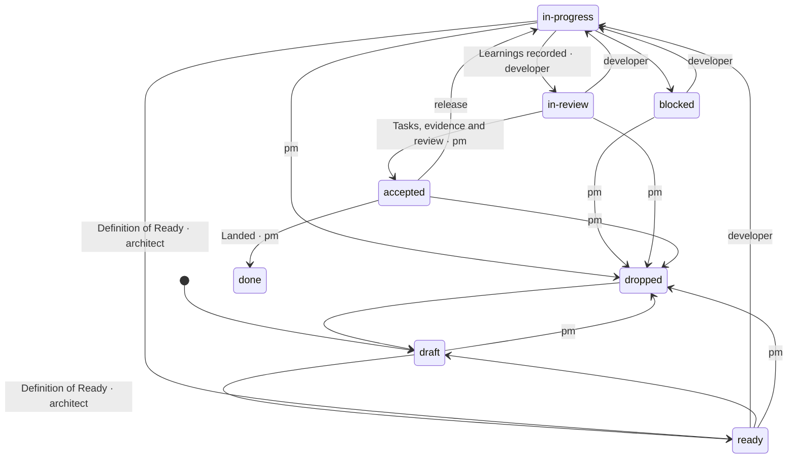
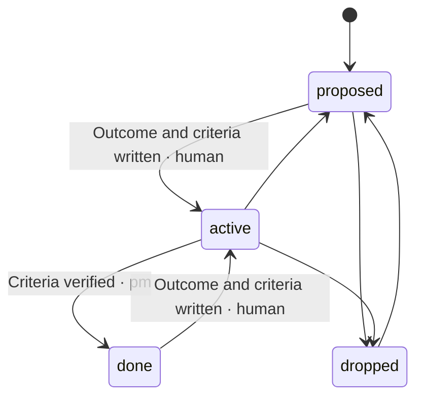
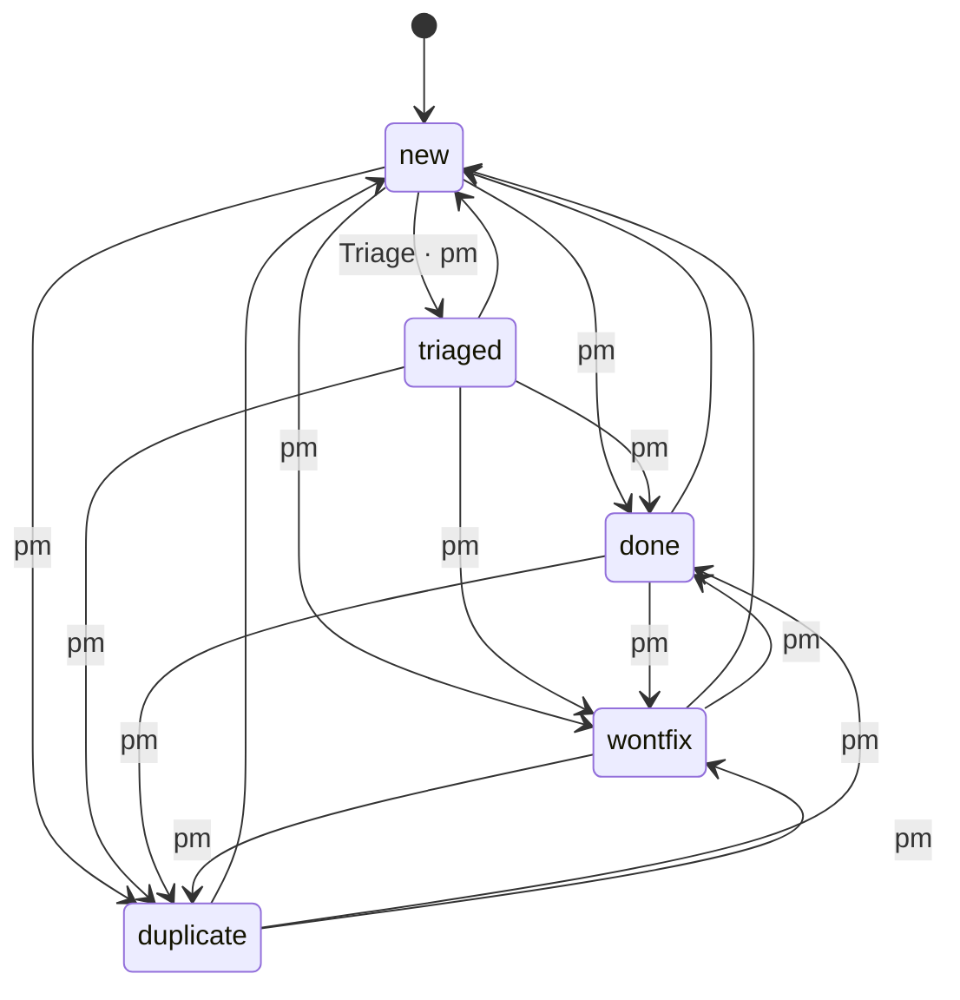
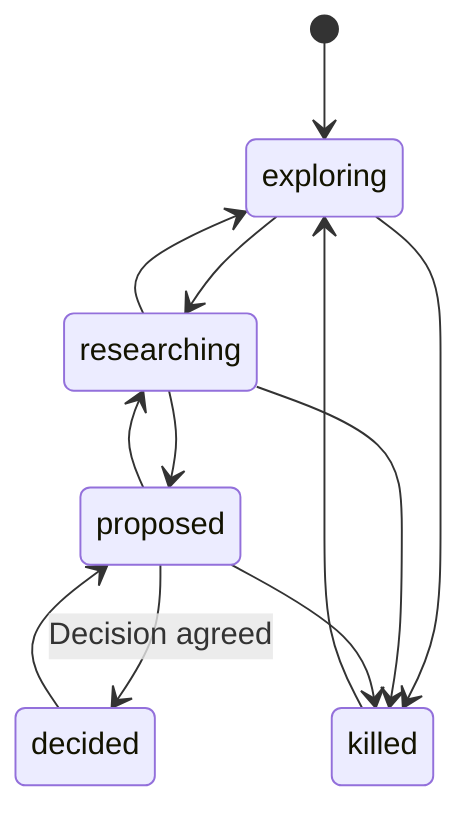

# Lifecycles and their gates

<!-- The generated blocks below are rewritten from the code by `npm run docs` in packages/crew (`npm run build` runs it too). Edit the prose around them, never inside them. -->

Every hub document moves through a status flow. A move outside the flow is refused; a move along it runs the gate on its
target status (`packages/crew/src/hub/core/work/transition-gates.ts:TRANSITION_GATES`) and, under the `lifecycle` preset,
is taken only by the role named on the edge (`packages/crew/src/hub/core/team/presets.ts:PRESETS`).

## Plan

From `packages/crew/src/hub/core/work/model.ts:PLAN_FLOW`.

<!-- generated:plan-flow -->

| From | To | Gate | Who (lifecycle) |
|---|---|---|---|
| `draft` | `ready` | Definition of Ready | architect |
| `draft` | `dropped` |  | pm |
| `ready` | `in-progress` |  | developer |
| `ready` | `draft` |  |  |
| `ready` | `dropped` |  | pm |
| `in-progress` | `blocked` |  |  |
| `in-progress` | `in-review` | Learnings recorded | developer |
| `in-progress` | `ready` | Definition of Ready | architect |
| `in-progress` | `dropped` |  | pm |
| `blocked` | `in-progress` |  | developer |
| `blocked` | `dropped` |  | pm |
| `in-review` | `in-progress` |  | developer |
| `in-review` | `accepted` | Tasks, evidence and review | pm |
| `in-review` | `dropped` |  | pm |
| `accepted` | `done` | Landed | pm |
| `accepted` | `in-progress` |  | release |
| `accepted` | `dropped` |  | pm |
| `dropped` | `draft` |  |  |
<!-- /generated -->

Steps gated by role that are not status changes:

<!-- generated:plan-steps -->
| Step | Who (lifecycle) | What |
|---|---|---|
| `item.regoaled` | pm | moves an item to another goal or off any (`regoal`, `triage --goal`); needs `--note` |
| `plan.regoaled` | pm | moves a plan with all its items to another goal (`regoal`); needs `--note` |
| `plan.assigned` | pm | opens a ready plan for a developer (`assign`); `start` needs the assignment |
| `plan.landed` | release | lands an accepted plan on the base (`land`); a failed land sends it back to in-progress |
| `plan.reassigned` | director | moves stuck work to someone else (`reassign`) |
| `plan.reviewed` | architect | reviews the code against the spec (`review`); a request for changes sends the plan back to in-progress |
| `plan.design-reviewed` | designer | reviews a UI plan's design in code and on screen (`review --design`); a request for changes sends the plan back to in-progress |
<!-- /generated -->

## Goal

From `packages/crew/src/hub/core/work/model.ts:GOAL_FLOW`.

<!-- generated:goal-flow -->

| From | To | Gate | Who (lifecycle) |
|---|---|---|---|
| `proposed` | `active` | Outcome and criteria written | human |
| `proposed` | `dropped` |  |  |
| `active` | `done` | Criteria verified | pm |
| `active` | `proposed` |  |  |
| `active` | `dropped` |  |  |
| `done` | `active` | Outcome and criteria written | human |
| `dropped` | `proposed` |  |  |
<!-- /generated -->

## Backlog item

From `packages/crew/src/hub/core/work/model.ts:ITEM_FLOW`.

<!-- generated:item-flow -->

| From | To | Gate | Who (lifecycle) |
|---|---|---|---|
| `new` | `triaged` | Triage | pm |
| `new` | `done` |  | pm |
| `new` | `wontfix` |  | pm |
| `new` | `duplicate` |  | pm |
| `triaged` | `new` |  |  |
| `triaged` | `done` |  | pm |
| `triaged` | `wontfix` |  | pm |
| `triaged` | `duplicate` |  | pm |
| `done` | `new` |  |  |
| `done` | `wontfix` |  | pm |
| `done` | `duplicate` |  | pm |
| `wontfix` | `new` |  |  |
| `wontfix` | `done` |  | pm |
| `wontfix` | `duplicate` |  | pm |
| `duplicate` | `new` |  |  |
| `duplicate` | `done` |  | pm |
| `duplicate` | `wontfix` |  | pm |
<!-- /generated -->

## Idea

From `packages/crew/src/hub/core/work/model.ts:IDEA_FLOW`.

<!-- generated:idea-flow -->

| From | To | Gate | Who (lifecycle) |
|---|---|---|---|
| `exploring` | `researching` |  |  |
| `exploring` | `killed` |  |  |
| `researching` | `proposed` |  |  |
| `researching` | `exploring` |  |  |
| `researching` | `killed` |  |  |
| `proposed` | `decided` | Decision agreed |  |
| `proposed` | `researching` |  |  |
| `proposed` | `killed` |  |  |
| `decided` | `proposed` |  |  |
| `killed` | `exploring` |  |  |
<!-- /generated -->
