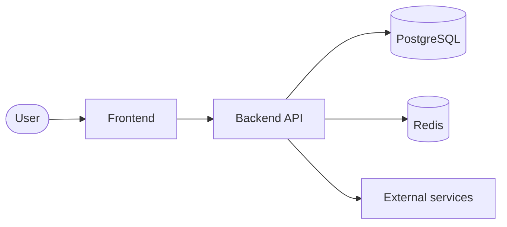

# Architecture

_Source of decisions: `.crew/config.yaml` and `docs/adr/`. Keep this document current when structure changes._

## Context
<!-- Who/what interacts with the system. Replace with project specifics. -->


## Containers / runtime units
| Unit | Tech | Responsibility |
|---|---|---|
| | | |

## Repository layout
<!-- The single home for the layout; README and CLAUDE.md link here. Show the designed tree,
     including folders that don't exist yet (they appear as code lands), with one line per
     directory. Every directory declared in `.crew/config.yaml → structure:` (root and source
     roots) must appear here; `check_structure.py --all` warns otherwise. -->
```text
<project>/
├── <backend_dir>src/<package>/
│   ├── <context>/        # <purpose>   (domain/ application/ adapters/ per arch pack)
│   ├── entrypoints/      # api/, worker/, cli/ (thin)
│   └── bootstrap.py      # composition root
├── <backend_dir>tests/   # unit/ contract/ integration/ api/
├── <frontend_dir>src/    # app/ shared/ <module>/ test/
└── docs/
```

### Where new code goes
<!-- Rows from the arch pack in use: hexagonal (domain / application / adapters / entrypoints),
     layered (api / services / repositories / models), CLI (cli / core / adapters), plus frontend modules. -->
| Adding… | Goes in |
|---|---|
| A business rule, entity or value object | `<…>/domain/` |
| A use case | `<…>/application/` |
| A DB table, external API client, cache | `<…>/adapters/` (implements a domain port) |
| An endpoint, worker job or CLI command | `<…>/entrypoints/` (thin, calls one use case) |
| A screen for a context | `<frontend_dir>src/<module>/` (network only in `services/`) |
| A generic UI component or hook | `<frontend_dir>src/shared/` |
| A test | mirrors the code it tests |

## Architecture style
<Chosen style (layered / hexagonal / …) and the dependency rules it implies, plus how they're enforced. Where things go is under Repository layout above; don't repeat it.>

## Request & data flow
<Walk through one representative request end to end: entry → validation → service → repository → DB/cache → response.>

## Cross-cutting concerns
- **Configuration:** env vars → typed settings, `.env.example`.
- **Logging & tracing:** structured logs, request ID.
- **Errors:** domain exceptions → Problem Details at the edge.
- **Auth:** <approach>.
- **Caching:** <what is cached, TTLs, invalidation>.
- **Local dev:** `docker compose up` brings up <services>.

## Quality attributes & trade-offs
<Performance, scalability, security, cost — what we optimize for and what we explicitly don't yet.>
